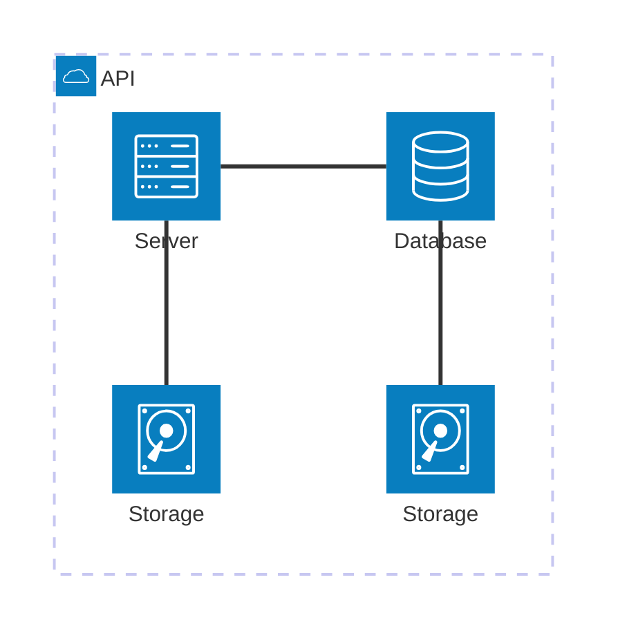

# Sozioökonomische Daten
## GLFS
This project is using [Git Large File Storage (git LFS)](https://git-lfs.com/).

### Enable on your device
```bash
git lfs install
```

### Add files to GLFS
```bash
git lfs track "*.psd"
git add .gitattributes
```

## Traefik & TLS
```bash
mkdir -p letsencrypt && touch letsencrypt/acme.json && chmod 600 letsencrypt/acme.json
```

## Architektur
