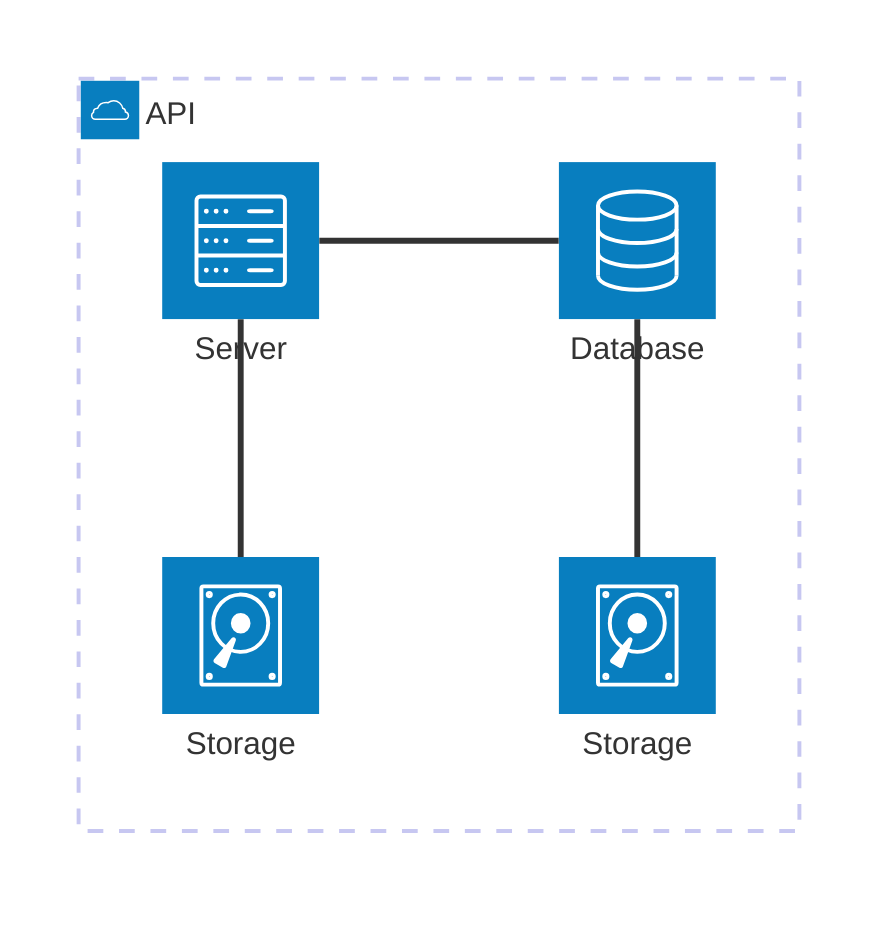
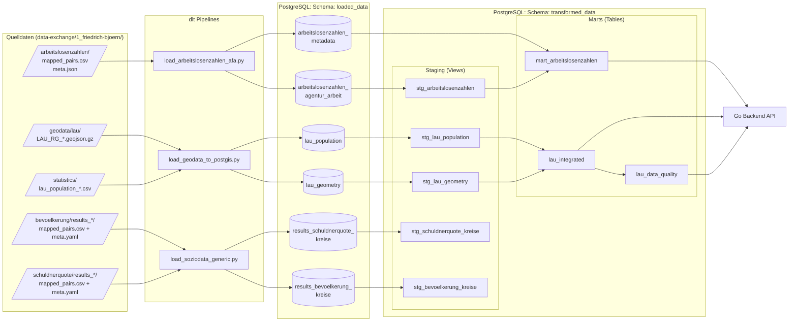

# Sozioökonomische Daten
## GLFS
This project is using [Git Large File Storage (git LFS)](https://git-lfs.com/).

### Enable on your device
```bash
git lfs install
```

### Add files to GLFS
```bash
git lfs track "*.psd"
git add .gitattributes
```

## Traefik & TLS
```bash
mkdir -p letsencrypt && touch letsencrypt/acme.json && chmod 600 letsencrypt/acme.json
```

## Deployment: Neues Backend-Image mit laufender Compose-Umgebung

Die Compose-Konfiguration nutzt für den Backend-Service das Image `${DOCKER_HUB_USERNAME}/backend:latest`.

```bash
cd backend/deployments

# Neues Backend-Image ziehen
docker compose pull backend

# Nur den Backend-Container mit neuem Image neu erstellen/starten
docker compose up -d --no-deps backend

# Status und Logs prüfen
docker compose ps backend
docker compose logs --tail=80 backend
```

Alternative in einem Schritt:
```bash
docker compose up -d --pull always --no-deps backend
```

## CI-Deployment auf der VM (erforderliche Schritte)

Damit der GitLab-Deploy-Job direkt auf dem Server ausführen kann (inkl. `git pull` und Nextcloud-Sync), müssen folgende Schritte einmalig auf der VM erledigt werden.

1. Shell-Runner auf der VM registrieren

Der bestehende Docker-Runner bleibt für Build-Jobs bestehen. Zusätzlich wird ein Shell-Runner mit Tag `deploy` benötigt.

```bash
# Runner installieren (Debian/Ubuntu, ohne curl|bash)
sudo apt-get update
sudo apt-get install -y ca-certificates gnupg curl
curl -fsSL https://packages.gitlab.com/runner/gitlab-runner/gpgkey \
    | sudo gpg --dearmor -o /usr/share/keyrings/gitlab-runner-archive-keyring.gpg
echo "deb [signed-by=/usr/share/keyrings/gitlab-runner-archive-keyring.gpg] https://packages.gitlab.com/runner/gitlab-runner/ubuntu/ $(. /etc/os-release && echo ${VERSION_CODENAME}) main" \
    | sudo tee /etc/apt/sources.list.d/gitlab-runner.list > /dev/null
sudo apt-get update
sudo apt-get install -y gitlab-runner

# Runner registrieren
sudo gitlab-runner register \
    --url "https://gitlab.htw-berlin.de" \
    --token "<PROJECT_RUNNER_TOKEN>" \
    --executor "shell" \
    --description "deploy-server" \
    --tag-list "deploy"
```

2. Zugriff auf Repo und Docker sicherstellen

Der Deploy-Job arbeitet im Server-Pfad `/root/soziooekonomische-daten`.

```bash
# Variante A: Runner als root betreiben (einfachster Weg bei /root/...)
sudo gitlab-runner install --user root --working-directory /root
sudo systemctl restart gitlab-runner

# Variante B (alternativ): Runner-User in docker-Gruppe aufnehmen
sudo usermod -aG docker gitlab-runner
sudo systemctl restart gitlab-runner
```

3. Nextcloud-Sync auf der VM konfigurieren

Das CI-Deploy ruft `backend/scripts/sync_nextcloud_data_exchange.sh` auf. Dafür muss auf der VM die produktive Sync-Env-Datei vorhanden sein.

```bash
cd /root/soziooekonomische-daten
cp backend/deployments/.env.nextcloud-sync.example backend/deployments/.env.nextcloud-sync
```

Danach in `backend/deployments/.env.nextcloud-sync` mindestens setzen:

- `RCLONE_SOURCE`
- `RCLONE_CONFIG_FILE` (falls nicht Default)
- optional `RCLONE_DEST`, `RCLONE_GEODATA_DEST`

Zusätzlich muss `rclone` auf der VM installiert und lauffähig sein.

4. Erforderliche GitLab CI-Variablen

Im Projekt unter GitLab CI/CD Variables müssen vorhanden sein:

- `DOCKER_HUB_USERNAME`
- `DOCKER_HUB_TOKEN`

5. Verhalten beim Deploy-Job

Bei Push auf `main` führt der Deploy-Job auf der VM aus:

1. `GIT_LFS_SKIP_SMUDGE=1 git pull --ff-only origin main`
2. `bash backend/scripts/sync_nextcloud_data_exchange.sh`
3. `docker compose pull backend`
4. Selektive Restarts (`backend` und bei relevanten Änderungen auch `pipeline`)

Damit werden Änderungen am Nextcloud-Sync-Script ebenfalls automatisch ausgerollt und angewendet.

## Speicherplatz-Verwaltung

### Diagnose

```bash
# Übersicht Dateisystem
df -h

# Größte Verzeichnisse finden
du -sh /* 2>/dev/null | sort -rh | head -20

# Docker-Speicherverbrauch
docker system df
docker volume ls
du -sh /var/lib/docker/volumes/* | sort -rh
```

### Bekannte Speicherfresser

**Docker Volumes:** GitLab-Runner legt bei jedem CI-Job temporäre Volumes für Cache und Build-Verzeichnisse an. Diese werden nach Abschluss des Jobs **nicht automatisch gelöscht** und können mehrere GB belegen.

Ungenutzte Runner-Volumes identifizieren und löschen:
```bash
# Volumes auflisten und prüfen
docker volume inspect $(docker volume ls -q)

# Ungenutzte Runner-Volumes löschen (pgdata NICHT löschen!)
docker volume rm <volume-name>

# Alternativ: alle ungenutzten Volumes auf einmal löschen
docker volume prune
```

> **Wichtig:** Das Volume `deployments_pgdata` enthält die PostgreSQL-Datenbankdaten und darf **nicht** gelöscht werden.

**Nicht verwendete Docker-Images aufräumen:**
```bash
docker system prune -a --volumes
```

## Architektur

### Komponentenübersicht


### Data Flow
