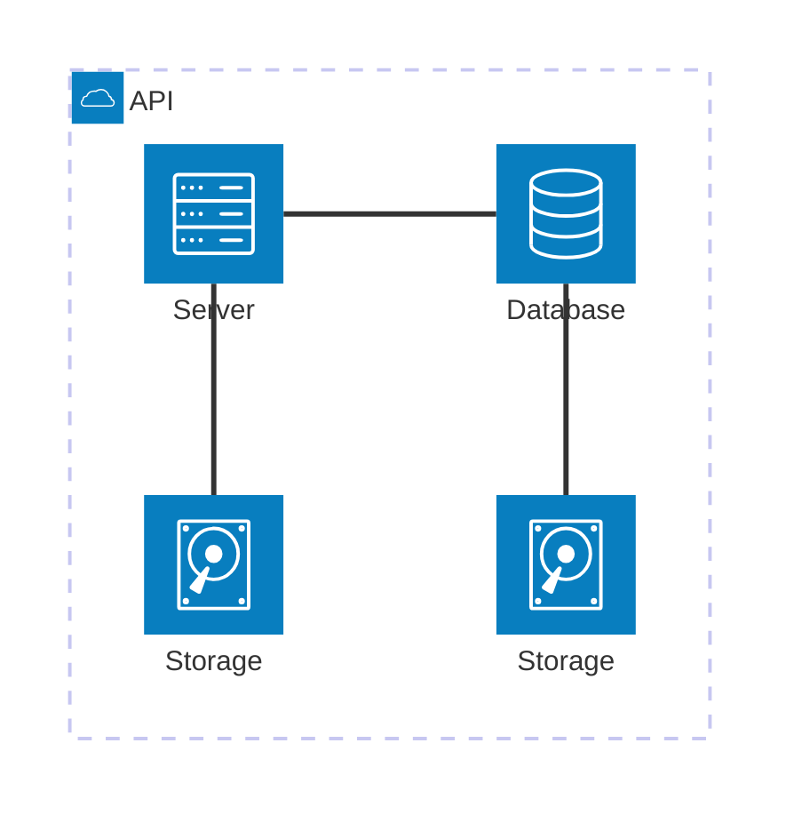
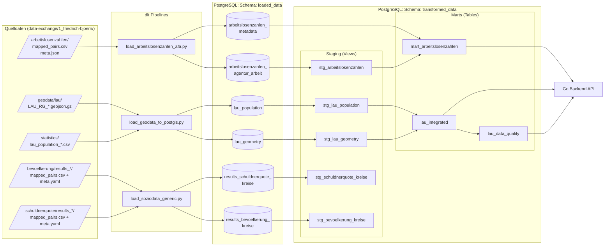

# Sozioökonomische Daten

## Lokal testen (Docker Compose)

`compose.local.yml` startet die gesamte Anwendung (Pipeline, Postgres/
PostGIS, Backend, Frontend) lokal auf dem Dev-Rechner — ohne Traefik/TLS,
ohne Docker-Hub-Images (Backend wird aus `backend/Dockerfile` gebaut, das
Frontend läuft als Vite-Dev-Server mit Hot Reload). Details und Portliste
stehen als Kommentar im Kopf der Datei.

```bash
docker compose -f compose.local.yml up --build
```

- Backend: http://localhost:8081/api/v1 (Swagger: `/api/docs/index.html`)
- Frontend: http://localhost:5174
- Adminer: http://localhost:8082 (Server `postgis`)

`transformed_data` ist zu Beginn leer. Pipeline einmalig anstoßen, sobald
die Container laufen:

```bash
docker compose -f compose.local.yml exec pipeline \
  bash /app/dlt/run_all_pipelines.sh
```

Geodaten laden dabei über lokale Fallback-Pfade (`geo-mapper/`,
`geo-importer/`) ohne weiteres Zutun. Die übrigen Kreis-Datensätze
(`arbeitslose`, `bevoelkerung`, `schuldnerquote`, ...) lesen aus
`data-exchange/1_friedrich-bjoern`, das im Repo-Checkout standardmäßig leer
ist (produktiv per Nextcloud-Sync befüllt, siehe
[backend/scripts/sync_nextcloud_data_exchange.sh](backend/scripts/sync_nextcloud_data_exchange.sh)).

!!! Ohne diese Rohdaten schlägt `run_all_pipelines.sh` bei `dbt snapshot`
fehl (alle `snap_results_*_kreise`-Snapshots referenzieren
`loaded_data.results_*_kreise`-Tabellen, die dlt beim Fehlen der
Quelldateien überspringt statt anzulegen) und bricht dort ab — `dbt run`
läuft dann nie, das `transformed_data`-Schema entsteht gar nicht erst, und
Backend-Endpunkte wie die NUTS-/LAU-Regionenliste liefern
`relation "transformed_data.mart_nuts3_summary" does not exist`. Das ist
kein Fehler in diesem Compose-Setup, sondern eine direkte Folge fehlender
Kreis-Rohdaten. Um lokal mit echten Werten zu testen, entweder den
Nextcloud-Sync einmalig ausführen (braucht Zugangsdaten in
`backend/deployments/.env.nextcloud-sync`, siehe
[backend/scripts/sync_nextcloud_data_exchange.sh](backend/scripts/sync_nextcloud_data_exchange.sh))
oder per Hand in den Pfad kopieren.

## Traefik & TLS
```bash
mkdir -p letsencrypt && touch letsencrypt/acme.json && chmod 600 letsencrypt/acme.json
```

## Deployment: Neues Backend-Image mit laufender Compose-Umgebung

Die Compose-Konfiguration nutzt für den Backend-Service das Image `ghcr.io/${GHCR_OWNER}/soziodata-backend:${IMAGE_TAG}` (GitHub Container Registry).

```bash
cd backend/deployments

# Neues Backend-Image ziehen
docker compose pull backend

# Nur den Backend-Container mit neuem Image neu erstellen/starten
docker compose up -d --no-deps backend

# Status und Logs prüfen
docker compose ps backend
docker compose logs --tail=80 backend
```

Alternative in einem Schritt:
```bash
docker compose up -d --pull always --no-deps backend
```

## Deployment: Geänderte Pipeline manuell auf dem Server ausführen

Da `pipeline/dlt/` und `pipeline/dbt/` als Volumes in den `pipeline`-Container eingebunden sind, reicht nach einem `git pull` auf dem Server ein Neustart des Containers, damit Änderungen wirksam werden.

```bash
cd /root/soziooekonomische-daten

# Aktuellen Branch/Stand ziehen
git pull --ff-only

# Pipeline-Container neu starten
cd backend/deployments
docker compose up -d --no-deps pipeline
```

### dlt-Pipelines + dbt manuell ausführen

Alles auf einmal (alle dlt-Datasets + dbt):

```bash
docker exec pipeline bash /app/dlt/run_all_pipelines.sh
```

Logs prüfen:
```bash
docker compose logs --tail=80 pipeline
```

## CI/CD und Deployment (GitHub Actions → Hetzner Cloud)

Der Server wird per Terraform bereitgestellt (`infra/`, Workflow `.github/workflows/infra.yml`), die Anwendung per
`.github/workflows/main.yml` ausgerollt. Erst-Einrichtung, benötigte Secrets/Variablen und DNS: [`infra/README.md`](infra/README.md).

Ablauf von `main.yml`:

1. **Push/PR auf `main`**: Tests (Go, Frontend-Build, mkdocs `--strict`, Syntax-Check dlt, `docker compose config`).
2. **Nur Push auf `main`** (bzw. manuell): Semantic-Release-Dry-Run → Images (`soziodata-backend|frontend|docs`) nach GHCR
   (`sha-<commit>`, `latest`, Version) → Semantic Release (Tag, Changelog, GitHub Release) → Deploy per SSH.
3. **Deploy** (`backend/scripts/deploy_remote.sh`): Commit auf dem Server auschecken, `.env`-Dateien aus Secrets schreiben,
   Nextcloud-Sync, `docker compose pull && up -d`. Optional (`initial_load`) danach dlt + dbt einmalig komplett ausführen.
4. **E2E** (Playwright, `frontend/web/app/e2e`) gegen die deployte Instanz; bei Fehlschlag Rollback auf den letzten guten Stand.

Der Deploy-Job bricht ab, solange `APP_HOST` nicht per DNS auf den Server zeigt (Let's-Encrypt-Challenge).
Der Server braucht `rclone` und die Nextcloud-Zugangsdaten (`RCLONE_SOURCE`, `RCLONE_CONF`), damit
`backend/scripts/sync_nextcloud_data_exchange.sh` läuft; ohne diese wird der Sync übersprungen.

## Datenbank-Backup

Nachts (02:17 Uhr) sichert `backend/scripts/backup_db.sh` das Schema `snapshots` (dbt-Historie) und
`loaded_data.dataset_metadata` per `pg_dump` in einen Hetzner-Object-Storage-Bucket (30 Tage Aufbewahrung).
Alles andere baut die Pipeline neu. Einrichtung, Restore und Restore-Reihenfolge: [docs/operations.md](docs/operations.md).

## Speicherplatz-Verwaltung

### Diagnose

```bash
# Übersicht Dateisystem
df -h

# Größte Verzeichnisse finden
du -sh /* 2>/dev/null | sort -rh | head -20

# Docker-Speicherverbrauch
docker system df
docker volume ls
du -sh /var/lib/docker/volumes/* | sort -rh
```

### Bekannte Speicherfresser

**Docker Volumes und Images:** Jedes Deployment zieht neue Images (`sha-<commit>`); alte Image-Versionen bleiben auf dem Server liegen und können mehrere GB belegen. Ungenutzte Volumes können sich ebenfalls ansammeln.

Ungenutzte Volumes identifizieren und löschen:
```bash
# Volumes auflisten und prüfen
docker volume inspect $(docker volume ls -q)

# Ungenutzte Volumes löschen (pgdata NICHT löschen!)
docker volume rm <volume-name>

# Alternativ: alle ungenutzten Volumes auf einmal löschen
docker volume prune
```

> **Wichtig:** Das Volume `deployments_pgdata` enthält die PostgreSQL-Datenbankdaten und darf **nicht** gelöscht werden.

**Nicht verwendete Docker-Images aufräumen:**
```bash
docker system prune -a --volumes
```

## Architektur

### Komponentenübersicht


### Data Flow
