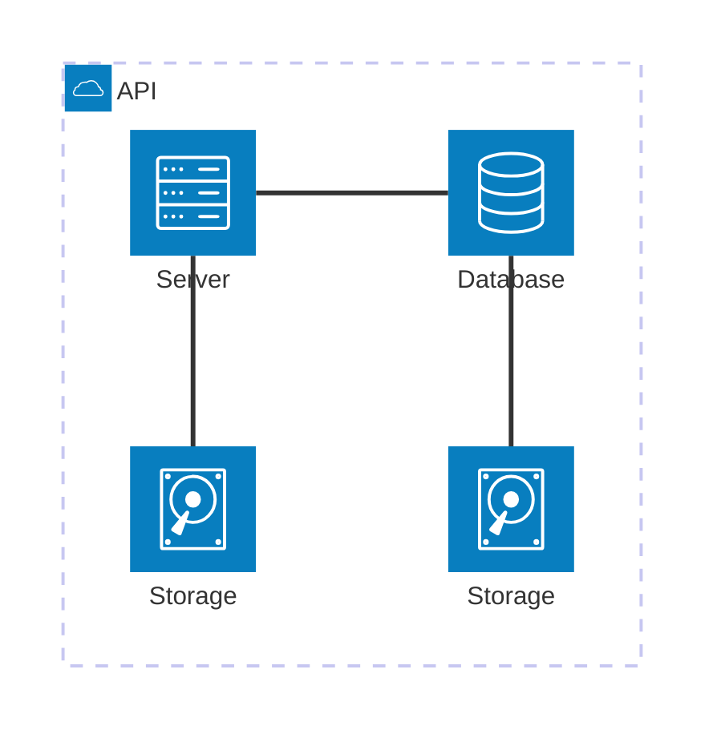
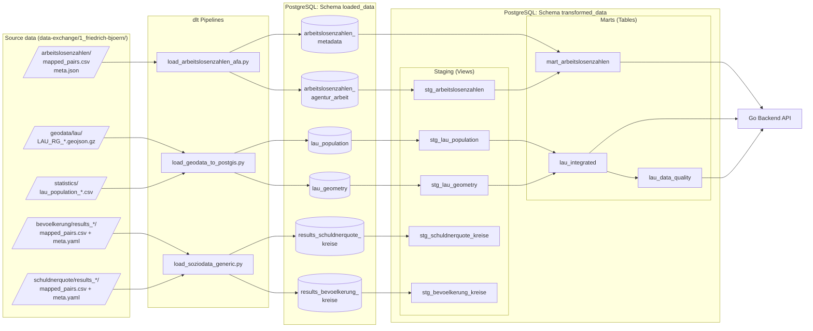
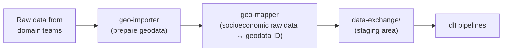

# Architecture

## Component overview

## Data flow

From the raw data all the way to the API, every dataset follows the same
path: **dlt** loads raw data unchanged into `loaded_data`, **dbt** builds
staging views, intermediate models, and marts (tables) in `transformed_data`
from it, which are then served by the **backend**.

Details on each step:

- **dlt** (Extract & Load): [pipeline/dlt.md](pipeline/dlt.md)
- **dbt** (Transform): [pipeline/dbt.md](pipeline/dbt.md)
- **Backend/API**: [backend/index.md](backend/index.md)

## Other modules

These modules prepare data *before* dlt runs and are only briefly placed in
context here (details in the respective READMEs in the repository):

- **`geo-importer/`** – downloads and cleans official NUTS/LAU geodata
  (GeoJSON, population statistics) as input for `geo-mapper/` and the
  dlt geodata pipeline.
- **`geo-mapper/`** – matches the socioeconomic raw datasets (from
  `data-exchange/`) to geodata IDs (LAU/NUTS) and produces the
  `mapped_pairs.csv`/`meta.yaml` files consumed by
  `dlt/load_soziodata_generic.py`.
- **`data-exchange/`** – exchange directory for intermediate raw-data
  states between project contributors; no code of its own, only data.

