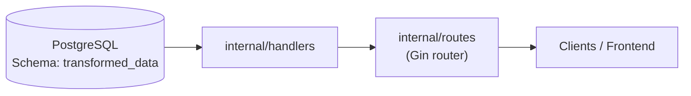

# Backend – Overview

Go REST API (framework: [Gin](https://gin-gonic.com/)) that reads exclusively
from the `transformed_data` schema produced by dbt and serves the
socioeconomic/geographic data for frontends/analyses.

Full details (git hooks, standard Go project layout) live in
[`backend/README.md`](https://gitlab.htw-berlin.de/s0595954/soziooekonomische-daten/-/blob/main/backend/README.md).

## Technology stack

- **Language/Framework:** Go, [Gin](https://gin-gonic.com/)
- **DB access:** [`sqlx`](https://github.com/jmoiron/sqlx) + `lib/pq` (PostgreSQL/PostGIS, read-only against `transformed_data`)
- **API docs:** [swaggo/swag](https://github.com/swaggo/swag) → `backend/docs/swagger.json` / `swagger.yaml`, served at `/api/docs/*any`
- **Entry point:** [`cmd/soziodata/main.go`](https://gitlab.htw-berlin.de/s0595954/soziooekonomische-daten/-/blob/main/backend/cmd/soziodata/main.go)

## Directory structure (excerpt)

| Path | Content |
|---|---|
| `cmd/soziodata/` | entry point (`main.go`): loads config, opens the DB connection, starts the router |
| `cmd/gen-models/` | code generator that produces Go models/handlers/routes from dbt schema YAMLs (see `handlers_soziodata_generated.go`, `models_soziodata_generated.go`) |
| `internal/config/` | loads `.env` + validates required variables against `.env.example` |
| `internal/routes/` | route definitions (`SetupRoutes`), CORS/logging middleware |
| `internal/handlers/` | HTTP handlers per resource (LAU, NUTS, Geo, unemployment, metrics, generic socioeconomic data) |
| `internal/models/` | data models (partly generated from dbt schemas) |
| `internal/pkg/` | shared internal helper packages |
| `docs/` | generated Swagger spec (`swag init`) |
| `configs/metrics_catalog.yaml` | catalog of derived metrics (`/metrics/derived`) |
| `deployments/docker-compose.yml` | production Compose stack (Traefik, PostGIS, backend, pipeline) |

## Data flow into the backend

The backend performs **no** transformation of its own – it only reads
finished marts/views from `transformed_data`, which are built by dbt (see
[Data Pipeline](../pipeline/index.md)).

## Further reading

- [API endpoints](api.md)
- [Local development](development.md)
- [Deployment](deployment.md)
