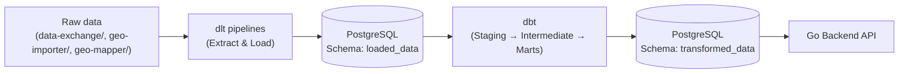

# Sozioökonomische Daten

This documentation covers the backend (Go API) and the data pipeline
(dlt + dbt) of the project. The remaining modules are briefly placed in
context on the [Architecture](architecture.md) page; details for them still
live in the `README.md` files of their respective folders.

## What does the project do?

Socioeconomic and geographic data (unemployment figures, population, debtor
quota, LAU/NUTS geodata, ...) are loaded from various sources, mapped onto
common regions (LAU/NUTS), historized, and served via a REST API.

## Modules at a glance

| Module | Purpose | Docs |
|---|---|---|
| [`backend/`](https://github.com/BjoernFuertges/Socioeconomic-Data/blob/main/backend/README.md) | Go API (Gin), reads from `transformed_data` | [Backend overview](backend/index.md) |
| [`pipeline/dlt/`](https://github.com/BjoernFuertges/Socioeconomic-Data/tree/main/pipeline/dlt) | Python pipelines that load raw/geodata into `loaded_data` | [dlt](pipeline/dlt.md) |
| [`pipeline/dbt/socioeconomic_data_pipeline/`](https://github.com/BjoernFuertges/Socioeconomic-Data/tree/main/pipeline/dbt/socioeconomic_data_pipeline) | Transformation, snapshots, NUTS/LAU harmonization | [dbt](pipeline/dbt.md) |
| `geo-importer/`, `geo-mapper/` | Prepares geodata (NUTS/LAU) and maps the socioeconomic raw data onto geodata IDs before it is loaded via dlt | [Architecture](architecture.md#other-modules) |
| `data-exchange/` | Storage for exchanged intermediate raw-data states between project contributors | [Architecture](architecture.md#other-modules) |

!!! note "Source of truth"
    This documentation complements the existing `README.md` files with a
    searchable, cross-referenced structure. Detailed knowledge about
    individual subfolders (Go project layout, git hooks, ...) stays in the
    READMEs and is linked here instead of being duplicated.

## Navigation

- **[Architecture](architecture.md)** – component overview and data flow across all modules
- **Backend** – API endpoints, local development, deployment
- **Data Pipeline** – dlt pipelines and dbt models (staging/intermediate/marts/snapshots)
- **[Operations](operations.md)** – disk space management, Docker maintenance
