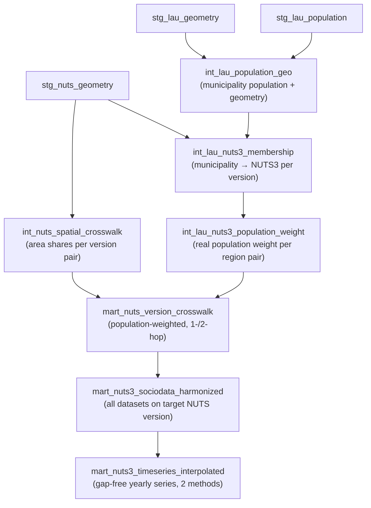

# dbt – Transformation

Project: [`dbt/socioeconomic_data_pipeline/`](https://gitlab.htw-berlin.de/s0595954/soziooekonomische-daten/-/tree/main/dbt/socioeconomic_data_pipeline).
Reads from the `loaded_data` schema (populated by dlt), writes to
`transformed_data`.

```bash
cd dbt/socioeconomic_data_pipeline
dbt deps      # once / when packages change (dbt_utils)
dbt snapshot  # advance historization
dbt run       # build staging/intermediate/marts
dbt test      # data-quality tests from the *_schema.yml files
```

The connection is configured via `profiles.yml` (see `profiles.example.yml`)
or the `DBT_PROFILES_DIR` environment variable.

## Layers

| Layer | Directory | Materialization | Purpose |
|---|---|---|---|
| Snapshots | `snapshots/` | `snapshot` (table with history) | historizes `loaded_data` tables over time (SCD-like) |
| Staging | `models/staging/` | View | 1:1 cleaned view of `loaded_data`/snapshots, type conversion, column naming |
| Intermediate | `models/intermediate/` | View/Table (depends on model) | building blocks that aren't consumed directly (e.g. crosswalks) |
| Marts | `models/marts/` | Table | finished fact/dimension tables consumed by the backend |

### Snapshots

Each `snap_results_*` snapshot typically uses the
[`soziodata_snapshot_query`](https://gitlab.htw-berlin.de/s0595954/soziooekonomische-daten/-/blob/main/dbt/socioeconomic_data_pipeline/macros/soziodata_snapshot_query.sql)
macro, which returns the latest value per `(geodata_id_nuts, year)`
(`distinct on` + `order by ... loaded_at desc`). Since different dlt load
runs may bring different metadata columns (`loaded_at` vs. `_dlt_load_id`),
the macro detects the available column at runtime via
`adapter.get_columns_in_relation`.

Datasets without `geodata_id_nuts` (e.g. LAU/municipality data such as
`snap_results_beschaeftigungsquote_gemeinden`) cannot use the shared macro
and define their own, adapted snapshot query instead.

## NUTS version harmonization and time-series interpolation

NUTS-3 boundaries change over time (e.g. 2013 → 2016 → 2021 → 2024 due to
territorial reforms). To allow time series to be compared consistently
across multiple years, there is a multi-stage harmonization pipeline in
`models/intermediate/` and `models/marts/`:



- **`int_nuts_spatial_crosswalk`** – pure area intersections between NUTS-3
  regions of two versions (`ST_Intersection`/`ST_Area`), including forward
  and backward version pairs.
- **`int_lau_population_geo`** / **`int_lau_nuts3_membership`** /
  **`int_lau_nuts3_population_weight`** – determine the **real** population
  weight per (source, target) region pair based on municipality (LAU)
  population. Weighting by the total population of the NUTS-3 source region
  itself would always cancel out during normalization (see the comment in
  `mart_nuts_version_crosswalk.sql`) – only the finer LAU level makes the
  population weighting actually effective.
- **`mart_nuts_version_crosswalk`** – combines area and population weight
  (falls back to area if no LAU population can be determined), including
  2-hop compositions (e.g. 2013 → 2016 → 2021).
- **`mart_nuts3_sociodata_harmonized`** – converts 14 datasets onto a common
  target NUTS version (default: `var('target_nuts_version', 2024)`,
  configurable via `dbt run --vars 'target_nuts_version: 2021'`): the 13
  county (Kreis) datasets (sourced directly from `loaded_data.results_*`)
  plus `beschaeftigungsquote-nuts3` (sourced via `ref()` from
  `stg_beschaeftigungsquote_nuts3`, since it is itself a population-weighted
  LAU→NUTS-3 aggregation rather than a raw loaded table). Dataset slugs are
  chosen to match the corresponding backend API route slug 1:1 (e.g.
  `erwerbstaetige_pro_1000_einwohner`, `beschaeftigungsquote-nuts3`) so the
  backend can join both sides without a separate mapping table – see
  `KreisDatasetConfig.IsHarmonized` in [API: fill_gaps](../backend/api.md#gap-free-time-series-fill_gaps).
- **`mart_nuts3_timeseries_interpolated`** – fills missing years per region
  and dataset with two alternative imputation methods (no extrapolation
  beyond the known time range), see below.
- **`models/marts/fill_gaps/api_*_fill_gaps.sql`** – per-dataset dbt views
  generated from a shared macro that project the generic timeseries mart back
  into the API-facing column shape of the standard dataset routes. These views
  are what the backend reads when `fill_gaps=true` is requested on the normal
  route.

### Interpolation methods and evaluation

`mart_nuts3_timeseries_interpolated` fills gaps in an otherwise gap-free,
per-`(nuts3_id, dataset_slug)` yearly series with **two alternative
estimates**, computed side by side so API consumers can see both instead of
a single, silently-chosen number:

| Column | Method | Description |
|---|---|---|
| `value_linear` | 1 – Linear interpolation | Linear interpolation between the last known value before and the next known value after the gap (`v = v_prev + (v_next − v_prev) × (year − year_prev) / (year_next − year_prev)`). |
| `value_peer_trend` | 3 – Peer-based carry-forward | The region's own last known value (immediately preceding year only, no multi-year carry-forward) multiplied by `1 + ⌀ relative change` of other regions in the same NUTS-2 group (first 4 characters of the NUTS-3 code) from that same preceding year to the gap year. |

`value` remains the "official" output value for backward compatibility
(original value, or the Method 1 estimate if missing). `is_interpolated`
flags estimated rows; `value_linear` / `value_peer_trend` /
`n_peer_regions` are only populated for interpolated rows
(`is_interpolated = true`) so that non-estimated rows aren't cluttered with
irrelevant alternative values.

**Evaluation methodology:** [`analysis/impute_missing_values.py`](https://gitlab.htw-berlin.de/s0595954/soziooekonomische-daten/-/blob/main/analysis/impute_missing_values.py)
implements both methods (plus a third, regression-based method that is
*not* used in production due to poor accuracy, see below) and evaluates
them with a leave-one-out procedure: 40 known values per dataset are
randomly hidden (only interior points, i.e. with a known year before *and*
after, are eligible), re-estimated with each method, and compared against
the real value. Across n=520 samples over all 13 Kreis datasets:

| Method | MAE | RMSE | MAPE | Win rate |
|---|---|---|---|---|
| 1 – Linear interpolation | 64.07 | 268.89 | **2.45 %** | **51.0 %** |
| 3 – Peer-based carry-forward | 82.48 | 343.22 | 3.57 % | 41.9 % |
| 4 – Multi-linear regression (not used) | 2071.65 | 8846.76 | 45.88 % | 7.1 % |

Full raw results (per-sample errors, per-dataset breakdown) are in
[`analysis/results/`](https://gitlab.htw-berlin.de/s0595954/soziooekonomische-daten/-/tree/main/analysis/results).

Takeaways:

- Linear interpolation (Method 1) is the more accurate method overall and
  wins the majority of samples, which is why it remains `value` for
  backward compatibility.
- Peer-based carry-forward (Method 3) is close behind and actually wins on
  several datasets with strong regional correlation (`arbeitsvolumen`,
  `auzubildende`, `medianeinkommen`, `schuldnerquote`, `sgb_ii_quote`,
  `wohngeldhaushalte`) – this is why both estimates are exposed via the API
  rather than only the "usually better" one.
- A naive multi-linear regression across all other indicators (Method 4)
  performs far worse, especially for absolute-count datasets
  (`bevoelkerung`, `arbeitslose`), due to multicollinearity between
  unstandardized absolute-count and percentage predictors. It is
  implemented in the analysis script for comparison but **not** used in
  the dbt model.

## Conventions

- Surrogate keys via `dbt_utils.generate_surrogate_key(...)`.
- Marts read directly from the outside (backend) document their columns in
  an adjacent `*_schema.yml` (including tests like `not_null`,
  `accepted_values`, `dbt_utils.accepted_range`).
- New county (Kreis) datasets follow the existing pattern
  `stg_<name>_kreise.sql` → `results_<name>_kreise` in
  `mart_nuts3_sociodata_harmonized` (see the `source_datasets` list there).
