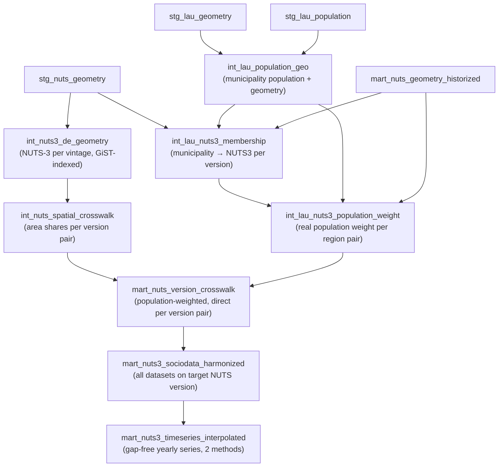
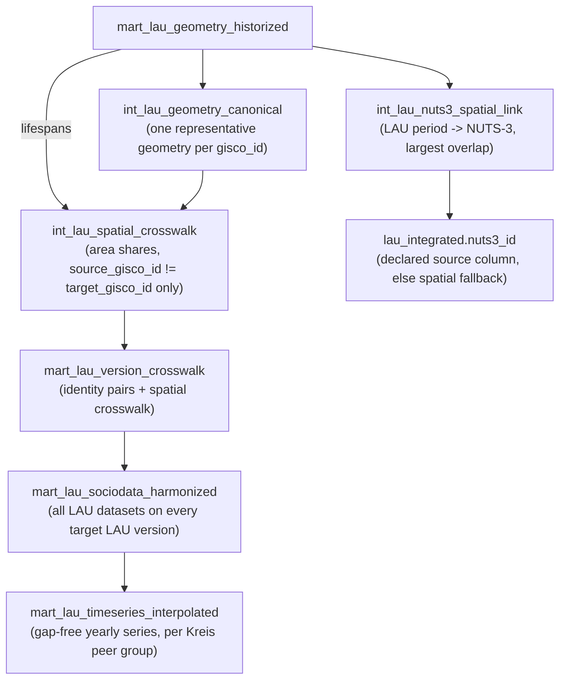

# dbt – Transformation

Project: [`pipeline/dbt/socioeconomic_data_pipeline/`](https://github.com/BjoernFuertges/Socioeconomic-Data/tree/main/pipeline/dbt/socioeconomic_data_pipeline).
Reads from the `loaded_data` schema (populated by dlt), writes to
`transformed_data`.

```bash
cd pipeline/dbt/socioeconomic_data_pipeline
dbt deps      # once / when packages change (dbt_utils)
dbt snapshot  # advance historization
dbt run       # build staging/intermediate/marts
dbt test      # data-quality tests from the *_schema.yml files
```

The connection is configured via `profiles.yml` (see `profiles.example.yml`)
or the `DBT_PROFILES_DIR` environment variable.

## Layers

| Layer | Directory | Materialization | Purpose |
|---|---|---|---|
| Snapshots | `snapshots/` | `snapshot` (table with history) | historizes `loaded_data` tables over time (SCD-like) |
| Staging | `models/staging/` | View | 1:1 cleaned view of `loaded_data`/snapshots, type conversion, column naming |
| Intermediate | `models/intermediate/` | View/Table (depends on model) | building blocks that aren't consumed directly (e.g. crosswalks) |
| Marts | `models/marts/` | Table | finished fact/dimension tables consumed by the backend |

### Snapshots

Each `snap_results_*` snapshot typically uses the
[`soziodata_snapshot_query`](https://github.com/BjoernFuertges/Socioeconomic-Data/blob/main/pipeline/dbt/socioeconomic_data_pipeline/macros/soziodata_snapshot_query.sql)
macro, which returns the latest value per `(geodata_id_nuts, year)`
(`distinct on` + `order by ... loaded_at desc`). Since different dlt load
runs may bring different metadata columns (`loaded_at` vs. `_dlt_load_id`),
the macro detects the available column at runtime via
`adapter.get_columns_in_relation`.

Datasets without `geodata_id_nuts` (e.g. LAU/municipality data such as
`snap_results_beschaeftigungsquote_gemeinden`) cannot use the shared macro
and define their own, adapted snapshot query instead.

## NUTS version harmonization and time-series interpolation

NUTS-3 boundaries change over time (e.g. 2013 → 2016 → 2021 → 2024 due to
territorial reforms). To allow time series to be compared consistently
across multiple years, there is a multi-stage harmonization pipeline in
`models/intermediate/` and `models/marts/`:



- **`int_nuts_spatial_crosswalk`** – pure area intersections between NUTS-3
  regions of two versions (`ST_Intersection`/`ST_Area`), including forward
  and backward version pairs. It self-joins `int_nuts3_de_geometry`, a
  GiST-indexed table copy of the German NUTS-3 rows of `stg_nuts_geometry`
  (the staging view re-parses WKT on every access and cannot be indexed).
- **`int_lau_population_geo`** / **`int_lau_nuts3_membership`** /
  **`int_lau_nuts3_population_weight`** – determine the **real** population
  weight per (source, target) region pair based on municipality (LAU)
  population. Weighting by the total population of the NUTS-3 source region
  itself would always cancel out during normalization (see the comment in
  `mart_nuts_version_crosswalk.sql`) – only the finer LAU level makes the
  population weighting actually effective (`int_lau_nuts3_membership` is
  only computed for the LAU population years the weight model actually
  resolves). Each municipality is assigned wholly to the NUTS-3
  region holding the largest share of its area (per version); its population
  goes to the resulting (source, target) pair. This majority assignment was
  evaluated against 648 Kreis versions with known truth and is clearly more
  accurate than area-proportional splitting
  (`analysis/data-analysis/nuts3_crosswalk_evaluation.ipynb`). Back-calculations
  to 2003/2006 for municipalities formed by incorporations (e.g. Potsdam,
  Sachsen-Anhalt) are estimates; no ground truth exists there.
- **`mart_nuts_version_crosswalk`** – combines area and population weight.
  `absolute_weight` is always in inhabitants; only a source region without
  any LAU population falls back to `area share × region population`
  (`weight_basis` = `'population'`/`'area'`, checked by
  `tests/assert_nuts_crosswalk_weights_consistent.sql`). Every pair
  of NUTS-3 vintages (2003/2006/2010/2013/2016/2021/2024) gets a direct
  mapping from its own spatial intersection; there is no chaining through
  intermediate versions (`n_hops` is always 1, kept for compatibility).
- **`mart_nuts3_sociodata_harmonized`** – converts 15 datasets onto every
  available target NUTS version simultaneously (2003/2006/2010/2013/2016/
  2021/2024, distinguished by the `target_version` column): the 14
  county (Kreis) datasets (sourced directly from `loaded_data.results_*`;
  `sv_beschaeftigte` comes from the Bundesagentur für Arbeit via
  `fetch_ba_sv_beschaeftigte.py`, all others from BBSR/INKAR)
  plus `beschaeftigungsquote-nuts3` (sourced via `ref()` from
  `stg_beschaeftigungsquote_nuts3`, since it is itself a population-weighted
  LAU→NUTS-3 aggregation rather than a raw loaded table; built in
  `int_beschaeftigungsquote_nuts3`). That aggregation is an approximation:
  the municipal rates are weighted by each municipality's total population
  from the newest Eurostat LAU vintage containing it (2024 for current
  municipalities), the same weight for every year,
  although the rate refers to residents aged 15–64 and Eurostat's LAU
  population is no reliable historical series (see
  `pipeline/dlt/fetch_lau_population.py`); the rate is workplace-based, so values above 100 % (commuter hubs, tiny
  municipalities) are kept: only negative values, the placeholder 0 (the source
  uses 0 for "not defined / missing") and outliers above 1000 are excluded
  (`has_valid_value = false`, also kept out of the LAU harmonization), and municipalities with fewer than 500 inhabitants carry
  `is_low_confidence = true` in `stg_beschaeftigungsquote_gemeinden` (var
  `low_confidence_population`) but still enter the weighted mean; `weight_coverage` in that mart
  gives the share of municipalities per NUTS-3 region and year that have a
  weight. Dataset slugs are
  chosen to match the corresponding backend API route slug 1:1 (e.g.
  `erwerbstaetige_pro_1000_einwohner`, `beschaeftigungsquote-nuts3`) so the
  backend can join both sides without a separate mapping table – see
  `KreisDatasetConfig.IsHarmonized` in [API: fill_gaps](../backend/api.md#gap-free-time-series-fill_gaps-and-timeseries).
  Each dataset carries a `measure_type` ('sum' for counts like
  `bevoelkerung`, 'weighted_avg' for rates/averages like `schuldnerquote`)
  that decides how a merge of several source regions into one target region
  is combined: extensive measures are summed (`Σ value_i × weight_i`),
  intensive measures are weighted-averaged (`Σ value_i × absolute_weight_i
  / Σ absolute_weight_i`, using the crosswalk's pre-normalization weight) –
  summing a percentage/average across a merge would otherwise silently
  shrink it. When aggregating to NUTS-0/1/2, Agenturbezirke or custom regions
  a third type, `weighted_avg_employees`, is used for values per employed
  person (`arbeitsvolumen`, `bruttoverdienst`): they are averaged weighted by
  the number of employed persons. That count is the dataset
  `erwerbstaetige_pro_1000_einwohner` – despite its (historical, public) slug
  the absolute number of employed persons in thousands, hence a `sum`.
  An entry can name another count as weight via `employee_slug`:
  `auszubildende` (per 1,000 SV-Beschäftigte) is weighted by
  `sv_beschaeftigte` – in these aggregations *and* already in the version
  crosswalk of the harmonized mart (`Σ value_i × emp_i × pw_i / Σ emp_i ×
  pw_i`, so rate × harmonized `sv_beschaeftigte` stays equal to the summed
  absolute counts, cf. derived metric `auszubildende-absolut`). The employee
  weight is only used if every contributing region has a valid one; otherwise
  the whole row falls back to the population weight (visible as
  `aggregation_method = weighted_avg_population`; harmonized mart, NUTS-0/1/2,
  Agenturbezirke and custom regions alike; only without population the area
  weight follows). Weights are never mixed within a row. `sv_beschaeftigte` starts in
  2007, so `auszubildende` 1995–2006 always uses the fallback.
  `has_valid_value` is false when any contributing source value fails the
  `has_valid_value` rule of its `stg_<slug>_kreise` model (re-stated as
  `valid_when` per dataset; `harmonized_value` itself is unchanged);
  `GET /metrics` skips these rows. The singular test
  `assert_harmonized_validity_matches_staging` keeps both rules in sync.
- **`mart_nuts3_timeseries_interpolated`** – fills missing years per region
  and dataset with two alternative imputation methods (no extrapolation
  beyond the known time range), see below.
- **`models/marts/fill_gaps/api_*_fill_gaps.sql`** – per-dataset dbt views
  generated from a shared macro that project the generic timeseries mart back
  into the API-facing column shape of the standard dataset routes. These views
  are what the backend reads when `fill_gaps=true` is requested on the normal
  route.
- **`mart_nuts3_summary`** (and the `mart_nuts0/1/2_summary` roll-ups behind
  `GET /nuts` and `GET /nuts/{nuts_id}`; population weight of
  `mart_nuts012_dataset_aggregate`) reads its indicators from the harmonized mart with
  `target_version = 2024`, not from staging per `geodata_year`, so one row
  never mixes Kreis datasets delivered on different NUTS vintages.

### Interpolation methods and evaluation

`mart_nuts3_timeseries_interpolated` fills gaps in an otherwise gap-free,
per-`(nuts3_id, dataset_slug)` yearly series with **two alternative
estimates**, computed side by side so API consumers can see both instead of
a single, silently-chosen number:

| Column | Method | Description |
|---|---|---|
| `value_linear` | 1 – Linear interpolation | Linear interpolation between the last known value before and the next known value after the gap (`v = v_prev + (v_next − v_prev) × (year − year_prev) / (year_next − year_prev)`). |
| `value_peer_trend` | 3 – Peer-based carry-forward | The region's own last known value (immediately preceding year only, no multi-year carry-forward) multiplied by `1 + ⌀ relative change` of other regions in the same NUTS-2 group (first 4 characters of the NUTS-3 code) from that same preceding year to the gap year. |

`value` remains the "official" output value for backward compatibility
(original value, or the Method 1 estimate if missing). `is_interpolated`
flags estimated rows; `value_linear` / `value_peer_trend` /
`n_peer_regions` are only populated for interpolated rows
(`is_interpolated = true`) so that non-estimated rows aren't cluttered with
irrelevant alternative values.

**Crosswalk estimates (`is_estimated`):** independent of gap filling, a value
converted to another NUTS version (`target_version` ≠ source version) can
itself be an estimate. Each municipality is assigned wholly to one Kreis
(majority of its area); where it straddles a boundary (assigned region holds
< `crosswalk_uncertain_area_share`, default 0.9, of its area) and such
municipalities make up ≥ `crosswalk_estimate_min_share` (default 5 %) of a
(source, target) pair's inhabitants, the pair is flagged `is_estimate` in
`mart_nuts_version_crosswalk`. The flag propagates as `is_estimated` through
`mart_nuts3_sociodata_harmonized` and `mart_nuts3_timeseries_interpolated` into
the NUTS `api_*_fill_gaps` views (typical cases: Potsdam/Dessau 2003, the
Sachsen-Anhalt reform 2007, Bremerhaven/Cuxhaven).

**Evaluation methodology:** [`analysis/data-analysis/impute_missing_values.py`](https://github.com/BjoernFuertges/Socioeconomic-Data/blob/main/analysis/data-analysis/impute_missing_values.py)
implements both methods (plus a third, regression-based method that is
*not* used in production due to poor accuracy, see below) and evaluates
them with a leave-one-out procedure: 40 known values per dataset are
randomly hidden (only interior points, i.e. with a known year before *and*
after, are eligible), re-estimated with each method, and compared against
the real value. Across n=520 samples over all 13 Kreis datasets:

| Method | MAE | RMSE | MAPE | Win rate |
|---|---|---|---|---|
| 1 – Linear interpolation | 64.07 | 268.89 | **2.45 %** | **51.0 %** |
| 3 – Peer-based carry-forward | 82.48 | 343.22 | 3.57 % | 41.9 % |
| 4 – Multi-linear regression (not used) | 2071.65 | 8846.76 | 45.88 % | 7.1 % |

Full raw results (per-sample errors, per-dataset breakdown) are in
[`analysis/data-analysis/results/`](https://github.com/BjoernFuertges/Socioeconomic-Data/tree/main/analysis/data-analysis/results).

Takeaways:

- Linear interpolation (Method 1) is the more accurate method overall and
  wins the majority of samples, which is why it remains `value` for
  backward compatibility.
- Peer-based carry-forward (Method 3) is close behind and actually wins on
  several datasets with strong regional correlation (`arbeitsvolumen`,
  `auszubildende`, `medianeinkommen`, `schuldnerquote`, `sgb_ii_quote`,
  `wohngeldhaushalte`) – this is why both estimates are exposed via the API
  rather than only the "usually better" one.
- A naive multi-linear regression across all other indicators (Method 4)
  performs far worse, especially for absolute-count datasets
  (`bevoelkerung`, `arbeitslose`), due to multicollinearity between
  unstandardized absolute-count and percentage predictors. It is
  implemented in the analysis script for comparison but **not** used in
  the dbt model.

## LAU version harmonization

LAU (municipality) boundaries change even more often than NUTS-3 ones
(mergers/splits), and GISCO re-generalizes the boundary lines on every
yearly vintage release even where nothing administrative changed. The same
harmonization pattern as NUTS-3 exists for LAU, structurally mirrored but
with two differences: there is no sub-LAU population layer to weight by
(LAU is the finest level in this project), so weighting is area-based; and
same-`gisco_id` geometry changes across periods are treated as a trivial
identity mapping (weight 1.0) without any spatial computation, rather than
going through the spatial crosswalk – LAU geometry historization collapses
far less than NUTS's (~12 periods per municipality out of 14 vintage years
on average, mostly re-generalization noise, not real changes), so
spatially intersecting every period against every other period of the same
municipality does not finish in reasonable time and answers the same
("unchanged") every time anyway. Only genuine cross-`gisco_id` overlaps
(actual mergers/splits) go through the spatial crosswalk.



- **`int_lau_spatial_crosswalk`** – area intersections between LAU
  geometries of *different* `gisco_id`s only (real mergers/splits). To
  stay tractable it intersects exactly one representative geometry per
  `gisco_id` (the latest known period, model `int_lau_geometry_canonical`)
  instead of every geometry period; the temporal assignment (source/target
  vintage years) stays exact because it comes from each `gisco_id`'s
  lifespan. `int_lau_geometry_canonical` is a standalone model (not a
  shared CTE) so both join sides use its GiST index on `geometry_3035` –
  a CTE referenced twice gets materialized by Postgres (≥ v12), loses
  index support and turns the self-join into an unindexed nested loop
  that does not finish.
  Only year pairs that span the change are emitted: if the source
  municipality still exists in the target year and the target municipality
  already existed in the source year (e.g. a merger survivor and its
  partner, both before the merger), there is no transfer between them.
- **`int_lau_nuts3_spatial_link`** – LAU→NUTS-3 assignment by largest
  intersection area (not `ST_Contains`, to tolerate boundary-touching
  noise), one row per LAU geometry period against the current NUTS-3
  vintage. Feeds the canonical `nuts3_id` in `lau_integrated`, used as a
  fallback whenever the declared source columns (`nuts_3_code`/`nuts_3`)
  are NULL – which they usually are for locally-loaded GISCO fixtures,
  since the raw LAU files don't carry a NUTS-3 property.
- **`mart_lau_version_crosswalk`** – union of a cheap identity mapping
  (same `gisco_id`, weight 1.0, no geometry computation, covering a
  municipality's entire lifespan across all its geometry periods) and the
  real spatial crosswalk for genuine boundary changes. The identity
  candidate only keeps the area share not claimed by spatial partners, and
  both are normalized together, so the weights per source municipality and
  version pair sum to 1 (test `assert_lau_crosswalk_weights_sum_to_one`).
- **`mart_lau_sociodata_harmonized`** / **`mart_lau_timeseries_interpolated`**
  – LAU-grain counterparts to the NUTS-3 harmonized/interpolated marts,
  same `measure_type` mechanism, same two interpolation methods but with
  the Kreis (first 5 digits of the Amtlicher Gemeindeschlüssel) as the peer
  group for Method 3 instead of the NUTS-2 prefix (LAU codes have no
  hierarchical structure).
- **`api_beschaeftigungsquote_gemeinden_fill_gaps`** – LAU counterpart to
  the NUTS `api_*_fill_gaps` views, built by the
  `render_lau_fill_gaps_view` macro; exposes `lau_version` instead of
  `nuts_version`.

## Reference versions (NUTS / LAU)

The target versions are not hard-coded in the models but live as vars in
`dbt_project.yml`: `reference_nuts_version` and `reference_lau_version`
(the version all aggregates, summaries and Agentur crosswalks are pinned to)
and `nuts_versions` / `lau_versions` (all versions the harmonized marts and
fill-gaps views produce). Models read them via `{{ var('...') }}`.

**New NUTS/LAU version:** load the new geodata (geo-importer -> dlt, incl.
crosswalk inputs), append the version to `nuts_versions` / `lau_versions`,
bump the reference var, rebuild all marts. The singular test
`assert_reference_versions_current` fails (severity error) while the vars
disagree with the geometry vintages in `stg_nuts_geometry` /
`stg_lau_geometry` (wrong reference version, missing or superfluous list
entry), so a forgotten update is caught. The backend needs no change: it
reads the supported `nuts_version` / `lau_version` values from the
harmonized marts at startup and defaults to the newest (restart it after the
rebuild), see [API: target versions](../backend/api.md#target-versions-nuts_version-lau_version).

## Custom-region aggregation

`POST /custom-regions/dataset-aggregate` needs no geometry work beyond the
polygon intersection, so the values it weights are prepared in two marts:

- **`mart_dataset_aggregation_meta`** – per (dataset, indicator): source
  level (`lau`/`nuts3`/`agentur`), `measure_type` (`sum`/`weighted_avg`/
  `weighted_avg_employees`, with the weighting count in `employee_slug`),
  `kind` and an optional finer slug (NUTS-3 employment rate → LAU). The
  NUTS-3 list duplicates the `source_datasets` of
  `mart_nuts3_sociodata_harmonized`; keep them in sync.
- **`mart_custom_region_unit_values`** – one long table of unit values
  (NUTS-3 / LAU pinned to target version 2024, Agenturbezirke monthly) plus
  the population and (NUTS-3 only, per the meta's `employee_slug`) the
  employee count used as weights. The LAU population weight is the 2024 LAU vintage's (matching
  the 2024 `target_gisco_id`), constant across observation years:
  `lau_integrated.year` is the Eurostat vintage, not an observation year.
- **`mart_nuts3_lau_aggregate`** – LAU→NUTS-3 cross-check (population sum
  per LAU vintage, population-weighted Beschäftigungsquote per observation
  year at LAU target version 2024, weighted by 2024-vintage population).
  `nuts3_id` is always the NUTS 2024 code (2024-vintage declaration, else
  spatial link), never the vintage's own, possibly older NUTS code.
  The population counts (`lau_region_count*`) belong to the population part
  only (0 without a LAU vintage); the quote has its own
  `lau_beschaeftigungsquote_region_count`.

The weighting formulas mirror `mart_agentur_dataset_aggregate`. Agenturbezirke
are only finer than NUTS-3 in Berlin, but their monthly figures have no
NUTS-3 equivalent, so that dataset is aggregated on Agenturbezirk level
everywhere.

## Conventions

- Surrogate keys via `dbt_utils.generate_surrogate_key(...)`.
- Marts read directly from the outside (backend) document their columns in
  an adjacent `*_schema.yml` (including tests like `not_null`,
  `accepted_values`, `dbt_utils.accepted_range`).
- New county (Kreis) datasets follow the existing pattern
  `stg_<name>_kreise.sql` → `results_<name>_kreise` in
  `mart_nuts3_sociodata_harmonized` (see the `source_datasets` list there).
