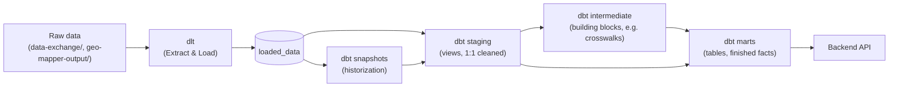

# Data Pipeline – Overview

The pipeline consists of two tools with a clear division of labor:

- **[dlt](dlt.md)** (`dlt/`) – Extract & Load: reads raw data (CSV/GeoJSON)
  and writes it **unchanged** into PostgreSQL, schema `loaded_data`.
- **[dbt](dbt.md)** (`dbt/socioeconomic_data_pipeline/`) – Transform:
  historizes, cleans, harmonizes, and aggregates the data into views/tables
  in the `transformed_data` schema, which are read by the backend.

## Order of a full run

See [`dlt/run_all_pipelines.sh`](https://gitlab.htw-berlin.de/s0595954/soziooekonomische-daten/-/blob/main/dlt/run_all_pipelines.sh):

1. All dlt scripts run (unemployment figures, geodata, generic
   socioeconomic datasets) → populate `loaded_data`.
2. `dbt deps` – install packages (`dbt_utils`).
3. `dbt snapshot` – advance historized snapshots from `loaded_data`.
4. `dbt run` – rebuild staging/intermediate/marts.

In production this happens inside the `pipeline` container (see
[Backend deployment](../backend/deployment.md#manually-running-a-changed-pipeline-on-the-server)).
